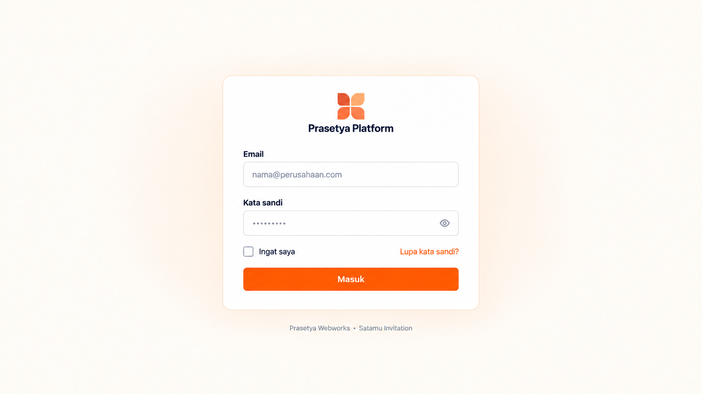
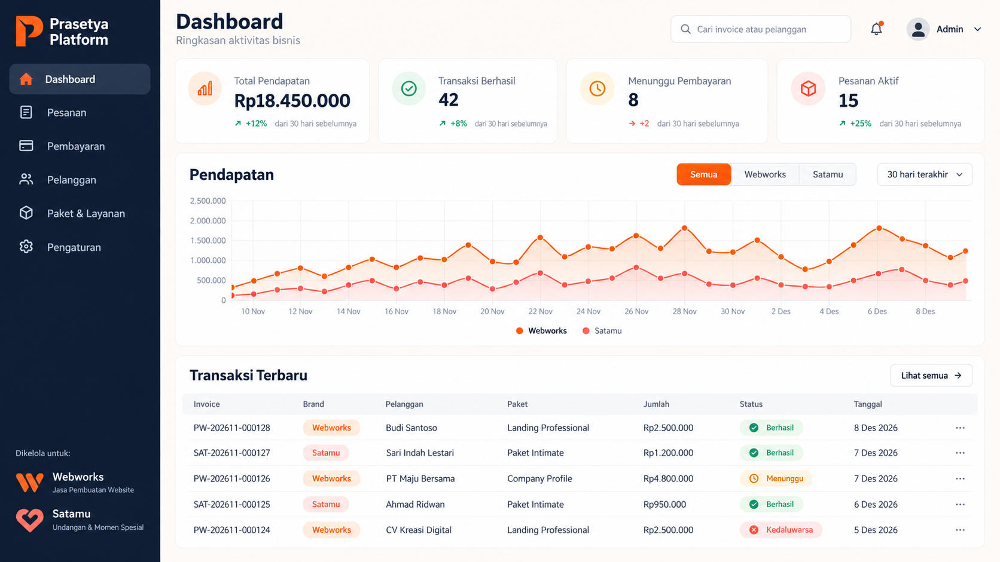

# Prasetya Platform Design System

This document is the source of truth for the Prasetya Platform login and back-office UI. The platform belongs to the same family as Prasetya Webworks and Satamu Invitation: typography, spacing, radius, and component behaviour stay aligned, while the admin interface uses a calmer parent-brand treatment.

## Document control

| Field | Value |
|---|---|
| Status | Approved for implementation |
| Owner | Prasetya Group |
| Applies to | Prasetya Platform back office |
| Review trigger | Product scope, brand, accessibility, or component API change |
| Related documents | [`architecture.md`](architecture.md), [`implementation-plan.md`](implementation-plan.md) |

## Purpose and audience

This specification aligns product, design, frontend, backend, and QA work. It defines the visual foundations, reusable component contracts, interaction patterns, responsive behaviour, accessibility requirements, and frontend quality gates. Deviations require a documented decision rather than an undocumented one-off implementation.

## Design principles

1. **Operational clarity:** the next action and current state must be easy to understand.
2. **Reuse by contract:** shared components expose stable, typed variants instead of copied markup.
3. **Accessible by default:** semantic structure, keyboard access, contrast, and focus states are release requirements.
4. **Progressive disclosure:** dense operational detail appears when needed, not all at once.
5. **Backend authority:** UI communicates server state and never invents payment or permission truth.

## Approved visual references

### Login



### Dashboard



The images define composition and visual direction, not literal production assets. Production must use the real SVG brand marks, semantic HTML, live data, and accessible components. Values shown in the dashboard image are sample data only.

## Product scope

Prasetya Platform is an internal application for:

- Prasetya Webworks orders and website projects.
- Satamu Invitation orders and invitation projects.
- Duitku payment monitoring and reconciliation.
- Customer, package, domain, and operational status management.

The customer-facing Astro websites keep their own brand identities. The platform uses the parent visual language and introduces orange or coral only when identifying a brand or chart series.

## Visual direction

- Minimal, warm, modern, and operationally clear.
- Deep navy provides structure, navigation, and hierarchy.
- Warm ivory keeps large work areas softer than pure grey.
- White cards use thin borders and restrained elevation.
- Prasetya orange is the main action colour.
- Satamu coral identifies Satamu records and chart series.
- Information density is moderate: clear tables without a cramped enterprise look.
- Decorative graphics are not used inside authenticated screens.

## Brand hierarchy

| Context | Colour | Use |
|---|---|---|
| Platform | Navy + Prasetya orange | Navigation, primary action, active state |
| Webworks | `#FF5100` | Brand badge, filters, chart series |
| Satamu | `#FF6542` | Brand badge, filters, chart series |

Do not recolour the Webworks or Satamu logos. Use the correct SVG assets from their source projects when the real platform repository is scaffolded.

## Semantic colour tokens

| Token | Value | Role |
|---|---|---|
| `--background` | `#FFFAF4` | App and login background |
| `--foreground` | `#0F172A` | Main text and sidebar |
| `--card` | `#FFFFFF` | Cards, tables, forms, popovers |
| `--card-foreground` | `#0F172A` | Text on cards |
| `--primary` | `#FF5100` | Primary action and active state |
| `--primary-foreground` | `#FFFFFF` | Text and icons on primary |
| `--secondary` | `#FFF1E8` | Soft orange surface |
| `--muted` | `#F6F3F0` | Neutral controls and table headings |
| `--muted-foreground` | `#646464` | Supporting text |
| `--border` | `#EADED5` | Default border |
| `--input` | `#DED6D0` | Input border |
| `--ring` | `#FF5100` | Focus ring |
| `--webworks` | `#FF5100` | Webworks identity and chart series |
| `--satamu` | `#FF6542` | Satamu identity and chart series |

### Derived accessible tokens

`--primary`, `--webworks`, and `--satamu` remain the approved identity colours. They do not reach WCAG AA as text or under white text, and the two brand colours cannot be told apart as chart series, so [ADR-0003](decisions/0003-accessible-colour-tokens.md) adds tokens for those jobs:

| Token | Value | Role |
|---|---|---|
| `--primary-strong` | `#C93F00` | Primary button fill and selected segment, with white text |
| `--primary-strong-hover` | `#AD3600` | Hover of the above |
| `--primary-text` | `#B83A00` | Links and accent text |
| `--webworks-text` | `#B83A00` | Webworks badge text |
| `--satamu-text` | `#B3341A` | Satamu badge text |
| `--chart-webworks` | `#C93F00` | Webworks chart series |
| `--chart-satamu` | `#FF8F75` | Satamu chart series, always with markers, legend, and table view |

### Status colours

| Status | Text | Surface | Use |
|---|---|---|---|
| Success | `#15803D` | `#DCFCE7` | Paid, completed, active |
| Warning | `#B45309` | `#FEF3C7` | Pending, needs attention |
| Danger | `#B91C1C` | `#FEE2E2` | Failed, expired, cancelled |
| Info | `#1D4ED8` | `#DBEAFE` | Processing, review |

Status must never rely on colour alone. Always include a text label and, where useful, an icon.

## Typography

- Display and headings: **Raleway**, fallback `sans-serif`.
- Body, forms, navigation, and tables: **Plus Jakarta Sans**, fallback `sans-serif`.

| Role | Size | Weight | Line height |
|---|---:|---:|---:|
| Page title | `32px` | 700 | 1.2 |
| Section title | `24px` | 700 | 1.25 |
| Card value | `28–32px` | 700 | 1.1 |
| Card title | `14px` | 500–600 | 1.4 |
| Body | `14px` | 400–500 | 1.5 |
| Table | `13–14px` | 400–600 | 1.4 |
| Caption | `12px` | 500–700 | 1.35 |

Numeric values use tabular numerals when the font supports them. Currency must use Indonesian formatting, for example `Rp18.450.000`.

## Spacing, radius, and elevation

- Base spacing unit: `4px`.
- Page content gap: `24px` desktop, `20px` tablet, `16px` mobile.
- Card padding: `20–24px`.
- Main card and form radius: `16px`.
- Compact controls and table containers: `12px`.
- Small badges: `8px`; use pills only for statuses and filters.
- Cards use a `1px` border and no shadow at rest.
- The login card may use one restrained warm shadow.
- Popovers and dialogs may use one stronger elevation layer.

Do not invent additional shadow tiers.

## Login page

### Composition

- Full viewport with a warm ivory background.
- One centred card, maximum width `480px`.
- Card remains compact and vertically centred.
- Small platform mark and `Prasetya Platform` wordmark at the top.
- The form begins directly after the wordmark; no marketing headline or subtitle.
- Footer below the card: `Prasetya Webworks • Satamu Invitation`.

### Form

- Visible labels for username and password. The username field has `autocomplete="username"` and no auto-capitalisation.
- Inputs are `48px` high with `12px` radius.
- Password input includes a show/hide control with an accessible label.
- `Ingat saya` sits opposite the hint *Lupa kata sandi? Hubungi admin lain.* There is no email reset ([ADR-0009](decisions/0009-single-access-users-username-login.md)).
- Submit button is full-width, `48px` high, orange, with white text.
- Validation errors appear below the related field and are announced to assistive technology.
- Loading state disables repeat submission and keeps the button label understandable.

### Responsive behaviour

- Card width: `min(480px, calc(100% - 32px))`.
- Mobile page padding: `16px`.
- The remember/forgot row may wrap below `360px`.
- The footer stays outside the card and may wrap to two lines.

## Authenticated app shell

### Sidebar

- Desktop width: `256px`.
- Fixed left, full viewport height, deep navy background.
- Platform identity appears at the top.
- Navigation items are `44–48px` high with simple line icons.
- Active item uses a lighter navy surface and orange icon/accent.
- Brand context appears near the bottom: Webworks and Satamu.
- Tablet/mobile sidebar becomes an accessible drawer.

Navigation order after the transaction workspace consolidation ([ADR-0010](decisions/0010-consolidated-transaction-workspace.md)):

1. Dashboard
2. Transaksi
3. Content Studio ([ADR-0011](decisions/0011-content-studio-authority-boundary.md))
4. Pengguna
5. Pengaturan

Event Pembayaran and Rekonsiliasi are secondary views under Transaksi. Transaction audit is on transaction detail, user audit is on user detail, and global/system audit is under Pengaturan → Aktivitas Sistem. The legacy GET routes redirect for at least one release cycle.

Every signed-in user sees every item: there is one access level ([ADR-0009](decisions/0009-single-access-users-username-login.md)). Pelanggan and Paket & Layanan return with their CRUD scope.

### Header

- Desktop height: approximately `72px`.
- Contains page title/context, global search, notification button, and admin menu.
- Search placeholder: `Cari invoice atau pelanggan`.
- Header remains visually quiet; it does not compete with page content.

### Main content

- Maximum useful width is unconstrained inside the app shell, with `24px` page padding.
- Warm ivory page background; content cards are white.
- Use a 12-column responsive grid where necessary.

## Dashboard

### Summary cards

Cards:

- Total Pendapatan
- Transaksi Berhasil
- Menunggu Pembayaran
- Gagal / Kedaluwarsa
- Pesanan Aktif

The fifth card is required by the first-release brief. Wide desktop uses a six-track grid with Total Pendapatan spanning two so its value is never broken, desktop three columns, tablet two, and mobile one. Each card includes a label, prominent value, restrained icon surface, and optional comparison text.

### Revenue chart

- Shows Webworks in orange and Satamu in coral.
- Includes brand filter and period selector.
- Chart tooltips must show date, brand, and formatted amount.
- Do not depend on line colour alone; use labels or distinct marker styles.

### Recent transactions

Columns:

1. Invoice
2. Brand
3. Pelanggan
4. Paket
5. Jumlah
6. Status
7. Tanggal
8. Row actions

The complete transaction page may add payment method and Duitku reference. On small screens, use horizontal scrolling with a sticky invoice column or switch to compact transaction cards; never compress every column until text is unreadable.

### Transaksi workspace

One workspace with three views ([ADR-0010](decisions/0010-consolidated-transaction-workspace.md)), at `/transactions?view=all|attention|events`. An unknown `view` falls back to `all`.

- Secondary navigation under the page title: a row of links, not a nested sidebar. The current view has `aria-current="page"`, a bar, and bold text; the row scrolls sideways on phones without clipping labels.
- **Semua**: the transaction list with every filter it had (search, brand, payment and order status, method, package, theme, event type and date, date range) and sorting.
- **Perlu Ditinjau**: the nine reconciliation groups as cards with counts, the total needing action, the selected group's description and threshold, and its issues. Duplicate webhooks are marked *Informasi, tidak dihitung*. Without `group`, the first group that needs action and has issues opens.
- **Event Pembayaran**: every webhook delivery, with invoice search, processing status, and date range.
- Each view keeps its own filters in the URL; switching view starts that view without the other's filters.
- Rows whose evidence has no order show the invoice and *Transaksi tidak ditemukan* instead of a link.
- The sidebar item **Transaksi** and the **Perlu Ditinjau** tab show the number of issues needing action (never duplicates). The header bell opens Perlu Ditinjau.

### User detail and system activity

Audit lives with what it is about ([ADR-0010](decisions/0010-consolidated-transaction-workspace.md)).

- **Pengguna → a user** (`/users/{id}`, from the name in the list): username, status, last sign-in, created, the same **Aksi** menu as the list, and **Aktivitas**: every audit entry about this user (created, renamed, activated or deactivated, password set, signed in and out), newest first, up to 100.
- **Pengaturan → Aktivitas Sistem** (`/settings/activity`, linked from Pengaturan, not in the sidebar): sign-in and sign-out, profile and password changes, packages, and unknown entities. Filters: search (action, actor, target), **Lingkup** (*Sistem* by default, *Semua audit* to search every entry), and date range. The table shows the action in words with its code below it.

### Content Studio

Manual planning, review, and posting records for single-image Instagram posts ([ADR-0011](decisions/0011-content-studio-authority-boundary.md)). Nothing here posts to Instagram, and a planned time passing changes nothing.

- One sidebar item, **Content Studio** (`/content` opens the calendar). Secondary navigation, the same underline tabs as Transaksi: **Kalender** | **Konten** | **Brand & Template** | **Pengaturan AI**.
- **Kalender** (`/content/calendar?week=YYYY-MM-DD&brand=&status=`): one week, Monday to Sunday in WIB, with previous/next/*Minggu ini* links and a status filter (brand appears once there is more than one). From `xl` the days are seven columns; below that they are day cards in two columns (`md`) or one. Each item card shows the time, the title, an image indicator, and its status in words and colour. Today's day is labelled *Hari ini*, not by colour alone. **Buat konten** opens a dialog: working title and planned date-time (WIB); the brand is fixed while there is one.
- **Komposisi pilar minggu ini** sits above the week: each active pillar as `count · share% / target N%` in text, with a bar and a target marker that repeat the numbers (never colour alone), and how many items have no pillar. Calendar and list also filter by pillar and campaign once a brand has them.
- **Konten** (`/content/items`): `DataTable` with search (title), brand and status filters, sorting by planned time or last change, and pagination. Columns: Judul, Brand, Rencana posting, Status, Revisi, Diubah.
- **Item detail** (`/content/items/{id}`), top to bottom:
  - **Ringkasan**: status, brand, planned time, active revision, creator, and **Ubah judul & jadwal** (dialog; plan only, never a new revision or a lost approval).
  - **Aturan brand**: the deterministic check of the current revision against the brand's current rules (version shown, and the version it met when submitted if that differs). Each finding is a `StatusBadge` in words, *Pelanggaran* (blocks submission) or *Peringatan* (informs), with its message; errors first. A clean check says so.
  - **Tinjauan**: one sentence saying where the item is and who acts next, then the actions that fit the status (*Ajukan untuk ditinjau*, *Setujui*, *Minta revisi*, *Tolak*). An action the user cannot take stays visible, disabled, with the server's reason below it (`aria-describedby`); for example the submitter sees *Revisi ini Anda ajukan sendiri. Pengguna lain harus menyetujuinya.* Revision requests and rejections need a note; approval may carry one.
  - **Paket posting** (approved or published only): **Unduh gambar**, copy buttons for caption + hashtags, caption, hashtags, and alt text (each announces *… disalin.* in a polite live region), the texts themselves, a four-step checklist that guides but is not stored, and **Tandai sudah dipublikasikan** (dialog: actual posting time in WIB, required; Instagram URL and note, optional). Once published it shows when, by whom, and the link.
  - **Asisten AI**: checkboxes for Caption, Hashtag, Alt text, and Arahan visual, and **Buat draft dengan AI**. When AI cannot run (off, wrong status, a run in progress, limits, provider failing) the button stays visible and disabled with the reason. The result is a new revision; while a run is queued or running the page refreshes every 3 seconds and announces the outcome in a polite live region. Runs are listed with status in words, fields, requester, resulting revision, tokens, and cost. The editor shows an info note on AI-drafted revisions, and the revision history says *dengan AI (model)*.
  - **Konten · revisi N**: Tujuan, Audiens, Brief*, Caption*, Hashtag, Alt text*, Arahan visual, each with a counter (hashtags count against 30), and the image at 4:5 with its size and type. Required-for-review fields carry `*`. Read-only, with the reason, while in review, rejected, or published. On approved content a warning explains that saving creates a new revision and returns it to review.
  - **Riwayat revisi**: every revision with author, submission, and decisions with notes; **Bandingkan revisi** shows changed fields side by side (danger surface before, success surface after, each labelled with its revision number) and whether the image changed.
  - **Aktivitas**: this item's audit, newest first, up to 100. Content audit never appears in system activity.
- **Brand & Template** (`/content/brands/{id}?tab=rules|pillars|campaigns|facts|activity`): one brand at a time (a brand select appears with more than one), tabs as links in the URL.
  - **Aturan**: read-only view of the current version (who, when, why), **Ubah aturan** opens the whole rule set as one form (texts, limits, and one-entry-per-line lists, each with a hint saying whether it is an error, a warning, or guidance) with a required change note, saved as a new version. *Riwayat versi* lists earlier versions. An empty brand says not to guess prices or claims.
  - **Pilar**: name, target share, description, Aktif/Nonaktif, add and edit in a dialog; the header states the active total out of 100%.
  - **Kampanye**: name, period (WIB days, inclusive), priority in words, objective, Aktif/Nonaktif.
  - **Fakta disetujui**: each fact with its source, campaign, and expiry; **Tidak berlaku** retires it with a reason. Retired facts sit in a closed disclosure.
  - **Aktivitas**: this brand's audit.
- **Pengaturan AI** (`/content/settings`): read-only. Status in words (ready, or why not), provider, model, prices, per-run limits, the week's spend against its limit with a bar that repeats the numbers, a closed *Cara mengaktifkan* disclosure naming the `.env` variables, and the last 30 runs. No key is ever shown or entered.
- Images: JPEG, PNG, or WebP, exactly 4:5, at least 1080×1350, at most 8 MB. The browser previews a chosen file and warns early about the wrong size; the server decides from the bytes.

### Transaction detail

Everything needed to investigate and check one transaction ([ADR-0010](decisions/0010-consolidated-transaction-workspace.md)).

- The four status cards (brand, amount, payment status, order status) stay above the tabs, so payment and order status are always visible and always separate.
- Three tabs (`Tabs`, keyboard arrows, the active tab marked by a bar and bold text, not colour alone), kept in the URL as `?tab=summary|payments|activity`:
  - **Ringkasan**: order and package snapshot, brand details, created and expiry times, admin notes, customer.
  - **Pembayaran**: *Perlu ditinjau* (this transaction's reconciliation issues, each marked *Perlu tindakan* or *Informasi* in words), then each payment attempt (`PaymentAttemptCard`: summary, the last gateway check, **Cek status** while the attempt is not paid, and its events behind a disclosure), then the webhook evidence. The tab shows the number of issues needing action.
  - **Aktivitas**: one newest-first timeline of order status history, payment events, webhooks, admin notes, and audit, each labelled with its source.
- **Cek status** opens the same reason dialog as before and returns to the same tab with the outcome as a toast.

### Pengguna

User management for a single access level ([ADR-0009](decisions/0009-single-access-users-username-login.md)).

- Page title **Pengguna**, description *Semua pengguna aktif dapat membuka semua menu*.
- Filter bar with search (name or username) and a status select, the same pattern as Transaksi and Audit Log; **Tambah pengguna** (primary button) sits at the end of the bar.
- `DataTable` columns: Nama (with a muted *(Anda)* on the signed-in user's row), Username (monospace), Status (`StatusBadge`: Aktif, Nonaktif), Masuk terakhir, Dibuat, and row actions. On small screens the table scrolls horizontally with the name column sticky, like the transaction list.
- Row actions, each opening a `ConfirmDialog` with a form or a confirmation:
  - **Ubah**: the name only; the username is shown read-only with the hint *Username tidak dapat diubah.*
  - **Atur kata sandi**: new password and confirmation. Not shown on the user's own row; they change it in Pengaturan with their current password.
  - **Nonaktifkan** (destructive) or **Aktifkan**. Deactivation explains that the user is signed out at once. On the user's own row, and for the last active user, the button is disabled and the reason is shown below it (`aria-describedby`).
- **Tambah pengguna** dialog: Nama, Username (hint: allowed characters, cannot be changed later), Kata sandi awal (hint: rules, share it privately), Ulangi kata sandi. Server errors appear under each field and replace its hint.
- Pengaturan no longer lists users. Its profile form edits the name only, with the username read-only.

## Core components

Build from shadcn-vue source components and customise through semantic tokens:

- Button
- Input
- Checkbox
- Select
- Dialog
- Sheet
- Dropdown Menu
- Table
- Badge
- Tabs
- Card
- Tooltip
- Toast
- Skeleton
- Pagination
- Alert Dialog
- Date Range Picker

Application-specific components:

- `AppSidebar`
- `AppHeader`
- `BrandBadge`
- `StatusBadge`, `PaymentStatusBadge`, `OrderStatusBadge`
- `MetricCard`
- `RevenueChart`
- `TransactionTable`
- `DataTable`, `TablePagination`, `FilterBar`, `SelectFilter`, `DateRangeFilter`, `SearchInput`
- `PaymentTimeline`, `AuditTimeline`, `PaymentSummary`
- `EmptyState`, `ErrorState`, `LoadingState`, `ConfirmDialog`
- `UserTable`, `UserFields`, `UserCreateDialog`, `UserEditDialog`, `UserPasswordDialog`, `UserStatusDialog`

### Reusability boundaries

Organise frontend code by responsibility so reusable pieces do not become one-off page implementations:

```text
resources/js/
├── components/
│   ├── ui/          # shadcn-vue primitives; no business rules
│   ├── layout/      # app shell, sidebar, header, page containers
│   └── shared/      # generic cross-feature components
├── features/
│   ├── auth/
│   ├── dashboard/
│   ├── transactions/
│   ├── payments/
│   ├── reconciliation/
│   ├── audit/
│   └── settings/
├── pages/           # thin Inertia page composition only
├── composables/     # reusable stateful behaviour
├── lib/             # pure helpers, formatters, and API utilities
└── types/           # shared TypeScript contracts
```

- A page composes feature components; it must not contain a second private component library.
- `components/ui` remains domain-neutral and is customised through variants and semantic tokens.
- Business-specific components stay inside their feature until two or more features genuinely need them.
- Prefer slots, typed props, and explicit variants over copied markup or boolean-prop combinations.
- Reuse formatting helpers for currency, dates, phone numbers, invoice numbers, and statuses.
- Server data contracts are typed; do not use `any` for API or Inertia props.
- Avoid premature generic abstractions. Extract a shared component only when its responsibility and API are stable.

### Required component states

Every reusable interactive component must define, when relevant:

- default, hover, focus-visible, active, and disabled;
- loading and submitting;
- validation error;
- empty and unavailable;
- permission denied;
- destructive confirmation.

## Tables and filters

- Table header uses a muted neutral surface.
- Row height is at least `52px`.
- Hover may use `--secondary` at low intensity.
- Filters sit above the table, not inside column headings.
- Active filters are removable and visible.
- Loading uses skeleton rows; empty and error states are distinct.
- Destructive actions always require confirmation.

## Motion

- Use motion only for navigation drawers, dialogs, dropdowns, and small state transitions.
- Duration: `150–220ms`.
- Avoid animated dashboard decoration.
- Respect `prefers-reduced-motion`.

## Accessibility

- Minimum contrast follows WCAG AA.
- All controls have visible focus states.
- Icon-only buttons have accessible names.
- Dialog focus is trapped and restored to its trigger.
- Tables have proper headers and captions where needed.
- Charts expose a text/table alternative for critical values.
- Sidebar and mobile drawer are keyboard operable.

## Implementation rules

- Stack: Laravel, Inertia.js, Vue 3, TypeScript, Tailwind CSS, and shadcn-vue.
- Use semantic tokens rather than raw colour values in components.
- Keep visible text in a central copy/i18n layer even if Indonesian is the only initial locale.
- Laravel owns authorisation and validation; Vue renders errors returned by Laravel.
- Use real brand SVGs in production, not the raster marks shown in mockups.
- Dashboard data must come from Laravel and never be embedded as permanent sample values.
- Webworks and Satamu records share common components; brand-specific differences are data, not copied pages.

## Frontend engineering baseline

### Performance

- Keep page entry bundles small; lazy-load charts, complex dialogs, and feature screens that are not needed initially.
- Import icons individually and avoid shipping unused component libraries.
- Paginate or virtualise large datasets; never render an unbounded transaction history.
- Debounce server-backed search and cancel stale requests.
- Use responsive image dimensions, modern formats, and explicit width and height to prevent layout shift.
- Use skeletons only for expected loading; do not hide errors behind endless loading states.
- Avoid deep watchers and unnecessary global reactive state. Prefer server state from Inertia and local feature state.
- Measure production builds; warnings about unexpectedly large chunks must be investigated before release.

### Quality gates

- TypeScript strict mode is required.
- ESLint, Prettier, Vue type checking, unit tests, and production build run in CI.
- Reusable components receive focused component tests for important variants and interactions.
- Critical flows receive browser tests: login, filter orders, inspect payment, and logout.
- No console errors, unhandled promises, or hydration warnings are accepted.
- Lighthouse is used as a regression signal, while authenticated workflow tests remain the release authority.

### Accessibility and maintainability

- Prefer native HTML semantics before adding ARIA.
- Feature components must not hardcode raw colours, API URLs, brand rules, or user-facing status mappings.
- Copy, route names, formatters, and status definitions have one source of truth.
- Keep components focused; move data orchestration into composables or page-level controllers when templates become difficult to scan.
- Document exceptional component behaviour next to the component or in this design system.

## Do

- Keep screens calm, clear, and operational.
- Use orange for primary action and coral only for Satamu identity.
- Make payment status and order status visibly separate, and fulfilment status when it arrives.
- Preserve generous whitespace around dense tables.
- Design loading, empty, error, and permission-denied states.

## Do not

- Add decorative landing-page graphics to the authenticated app.
- Use a dark main canvas; navy is reserved for the sidebar and key structure.
- Use excessive gradients, glassmorphism, or heavy shadows.
- Hide labels in favour of placeholders.
- Treat the Duitku callback page as proof of payment; verified backend state is authoritative.
- Mix Webworks and Satamu colours without a semantic brand purpose.

